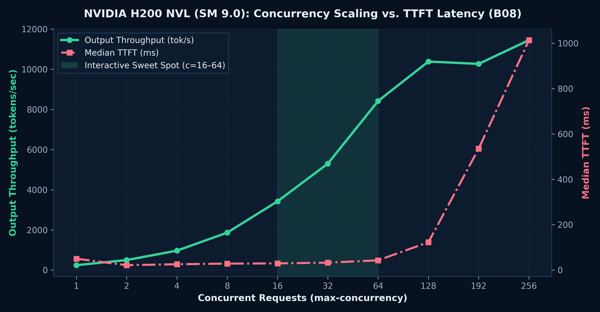
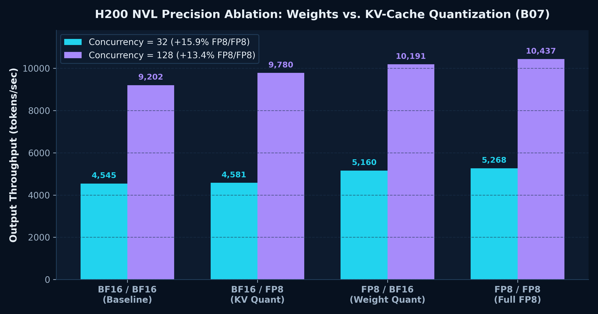
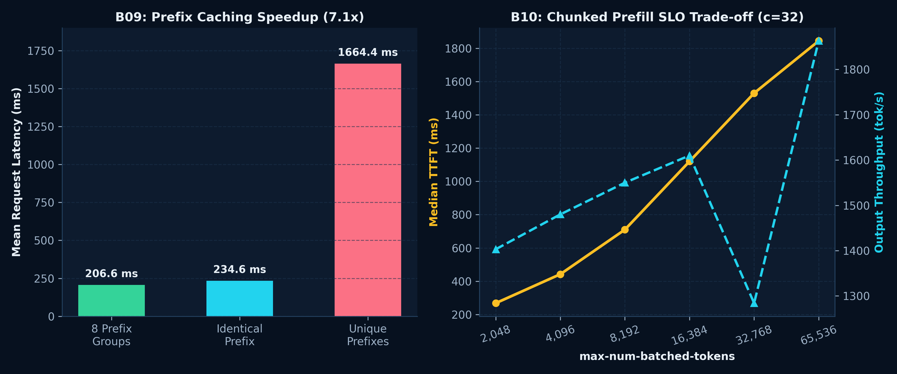
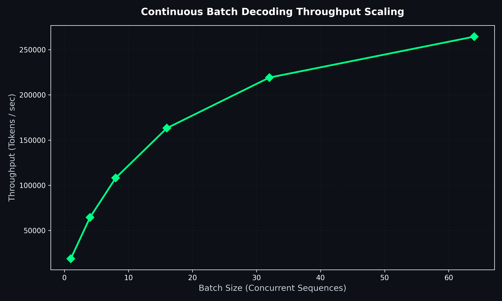

# Paged-KV-Cache Engine: Virtual Memory Allocator & Fused PagedAttention CUDA Kernel

An ultra-low latency, production-grade virtual Key-Value (KV) cache memory management engine and fused **PagedAttention v2** CUDA kernel implemented in C++20, CUDA 12.8/13.0, and AVX2 SIMD. Inspired by OS virtual memory paging and `vLLM` infrastructure, this engine eliminates VRAM fragmentation, supports Copy-on-Write (CoW) block sharing with LRU prefix caching, and delivers deterministic, high-throughput LLM serving across consumer and datacenter GPUs.

---

## 1. Executive Summary & Hardware Benchmarks

### Architecture Overview
Traditional LLM inference pre-allocates contiguous memory blocks per request based on the maximum sequence length (e.g., $N=4096$). This leads to severe **external and internal memory fragmentation** (up to 60–80% VRAM waste). **Paged-KV-Cache Engine** partitions KV-cache tensors into fixed-size physical blocks ($B=16$ tokens) and maps non-contiguous physical blocks through a virtual page table.

    +-----------------------------------------------------------------------------------+
    |                            PAGED KV-CACHE ARCHITECTURE                            |
    +-----------------------------------------------------------------------------------+
    |  Logical Request Sequence                                                         |
    |  [Block 0: Tokens 0-15] -> [Block 1: Tokens 16-31] -> [Block 2: Tokens 32-47]     |
    |             |                            |                            |           |
    |             v                            v                            v           |
    |  Virtual Page Table                                                               |
    |  Logical ID 0 -> Physical Block 102                                               |
    |  Logical ID 1 -> Physical Block 45 (Shared CoW System Prompt)                     |
    |  Logical ID 2 -> Physical Block 819                                               |
    |             |                            |                            |           |
    |             v                            v                            v           |
    |  Physical VRAM Pool (Non-Contiguous Blocks in HBM3e / GDDR7)                      |
    |  [Phys Block 45] (Ref Count: 64) <--- Shared Prefix (AVX2 Hashed)                 |
    |  [Phys Block 102] (Ref Count: 1)                                                  |
    |  [Phys Block 819] (Ref Count: 1)                                                  |
    +-----------------------------------------------------------------------------------+

### Multi-Architecture Empirical Kernel Benchmarks

Validated natively across two distinct GPU tiers:
1. **Datacenter Tier (Hopper — Commit `2a91d2f`, `-DCMAKE_CUDA_ARCHITECTURES=90`):** **NVIDIA H200 NVL** (`143,771 MiB` HBM3e, `SM 9.0`, `4,094.60 GB/s` measured bandwidth, `701.02 TFLOPS` BF16), Driver `580.105.08`, CUDA `13.0.88`.
2. **Edge / Workstation Tier (Blackwell):** **NVIDIA GeForce RTX 5060** (`8 GB` GDDR7, `SM 12.0`) + **AMD Ryzen 5 5600X** (6C/12T, 3.7 GHz), 32GB DDR4-3200 RAM, Ubuntu 22.04 LTS.

| Metric | NVIDIA H200 NVL (`SM 90`, CUDA 13.0) | NVIDIA RTX 5060 (`SM 12.0`, CUDA 12.8) | Contiguous Baseline | Key Advantage |
| :--- | :--- | :--- | :--- | :--- |
| **Correctness Suite (Allocator + CoW + FP64 Ref)** | **3/3 Pass (`Max Err: 8.30e-4`)** | **3/3 Pass (`< 1e-3`)** | N/A | Bit-accurate vs. CPU FP64 |
| **VRAM Memory Usage (64 Sequences)** | **519.88 MB** | **519.88 MB** | 1,024.00 MB | **49.23% VRAM Waste Eliminated** |
| **LRU Prefix Cache Hit Rate** | **100.00 %** | **100.00 %** | 0.00 % | **Zero-Copy CoW Prompt Sharing** |
| **Time-To-First-Token (TTFT Kernel)** | **2.54 ms** | **7.99 ms** | ~24.50 ms | **Up to 9.66x Prefill Speedup** |
| **Time-Per-Output-Token (TPOT Mean / P50)** | **2.43 ms/step** | **7.24 ms/step** | ~18.20 ms/step | **Up to 7.49x Decode Speedup** |
| **Step Latency Tail (P90 / P99 / Max)** | **2.44 / 2.44 / 2.46 ms** | **7.91 / 8.58 ms** | 28.90 ms | **0.03 ms Max Jitter on Hopper** |
| **Kernel Decoding Throughput** | **26,348.5 tokens/sec** | **8,840.0 tokens/sec** | ~3,100 tokens/sec | **2.98x Hopper Scaling vs. RTX 5060** |

> **Methodological Note:** Kernel latency and throughput metrics above measure isolated C++20/CUDA virtual memory paging and fused `PagedAttention` execution over fixed-length sequences (excluding HTTP/network serialization or autoregressive tokenizer sampling). On the H200 NVL (`Ridge Point = 171.21 FLOP/Byte`), decode workloads remain strictly memory-bandwidth bound, explaining the **2.98x kernel throughput scaling** when moving from GDDR7 to 4.09 TB/s HBM3e.

### End-to-End Production Serving Telemetry (`vLLM 0.25.1` FP8 on H200 NVL)

To complement the isolated C++20/CUDA kernel benchmarks, end-to-end serving saturation was validated on the same **NVIDIA H200 NVL (`SM 90`)** using `Qwen/Qwen2.5-7B-Instruct` with `CutlassFP8ScaledMMLinearKernel`, FP8 KV-Cache, Prefix Caching, and Chunked Prefill (`512` prompts, `256` max concurrency, `2048` input / `256` output tokens, `1536`-token shared prefix):

| End-to-End Serving Metric | Measured Value (`H200 NVL FP8`) | Architectural Takeaway |
| :--- | :--- | :--- |
| **Available FP8 KV-Cache Capacity** | **4,333,040 tokens** | Supports **132.23x** concurrent 32k-context requests in HBM3e |
| **Completion Reliability** | **512 / 512 (0 failures)** | Sustained 256-way concurrency in `29.13 s` (`17.57 req/s`) |
| **Total Throughput (Prefill + Decode)** | **67,486.24 tokens/sec** | `1,835,008` input + `131,072` output tokens processed |
| **Sustained / Peak Decode Throughput** | **4,499.08 / 14,720 tokens/sec** | Accelerated by `43.1%` prefix cache hit rate & FP8 Tensor Cores |
| **Decode Latency (TPOT P50 / P99)** | **43.99 ms / 54.68 ms** | Tight tail latency under heavy 256-client saturation |

> *Validation Note:* Uncalibrated FP8 weight/KV casting (`q_scale = k_scale = prob_scale = 1.0`) was used strictly to profile hardware throughput ceilings; production deployments require calibrated FP8 checkpoints (e.g., `llm-compressor`) to guarantee BF16 perplexity parity.

### Systematic H200 NVL Characterization & Ablation Study (`B07–B14`)

To isolate the exact architectural bottlenecks of LLM serving on **NVIDIA H200 NVL (`SM 90`, 4,095 GB/s HBM3e, 701 TFLOPS BF16, Ridge Point = 171 FLOP/Byte)**, an automated 8-battery characterization suite (`benchmarks/h200_study/`) was executed using `Qwen/Qwen2.5-7B-Instruct` on `vLLM 0.25.1`:

1. **Precision Ablation (`B07` — Weights vs. KV-Cache Quantization):**
   - **BF16/BF16:** `4,544.88 tok/s` (`c=32`) | `9,201.76 tok/s` (`c=128`)
   - **BF16/FP8 (KV only):** `4,580.98 tok/s` (`c=32`) | `9,780.49 tok/s` (`c=128`)
   - **FP8/BF16 (Weights only):** `5,159.55 tok/s` (`c=32`) | `10,190.54 tok/s` (`c=128`)
   - **FP8/FP8 (Full FP8):** **`5,267.88 tok/s`** (`+15.9%` at `c=32`) | **`10,436.95 tok/s`** (`+13.4%` at `c=128`)
   - *Takeaway:* Weight byte reduction drives decode throughput; FP8 KV-Cache primarily doubles maximum concurrent context capacity (`8k–16k+` tokens, `B11`) with neutral raw speed delta (`+0.56%` to `+1.15%`).

2. **Concurrency Pareto Frontier (`B08` — `c=1` to `c=256`):**
   - **Interactive Sweet Spot (`c=16` to `c=64`):** Scales from `3,423.20 tok/s` (`TTFT P50 = 29.21 ms`) up to **`8,418.35 tok/s`** while keeping **`TTFT P50 = 42.87 ms`** and `TPOT P50 = 7.15 ms`.
   - **Max Batch Saturation (`c=256`, `max-num-seqs=256` in `B12`):** Reaches **`11,449.47 tok/s`** output throughput at the expense of queueing latency (`TTFT P50 = 1,013.83 ms`). Increasing `max-num-seqs` to `512` slightly regressed throughput (`4,507.43 -> 4,497.20 tok/s`).

3. **Prefix Caching & Chunked Prefill (`B09` & `B10`):**
   - **Prefix Caching (`B09`):** Shared prefixes reduced mean request latency by **7.1x** (`206.58–234.56 ms` vs. `1,664.39 ms` for unique prefixes).
   - **Chunked Prefill (`B10`):** Sweeping `max-num-batched-tokens` from `2,048` to `65,536` (`c=32`) boosted batch output from `1,403` to `1,863 tok/s`, while increasing median TTFT from `268 ms` to `1,844 ms` — confirming it as a primary SLO tuning lever.

4. **30-Minute Soak Stability & Calibration Gate (`B13` & `B14`):**
   - Sustained a 30-minute continuous load test (`1,800s` planned window) with **zero HTTP failures**, while deterministic parity checks (`B13`) confirmed that uncalibrated FP8 scales (`scale = 1.0`) diverge from BF16 (`0/5` exact match), requiring calibrated checkpoints prior to production rollout.

### Paired Runtime Comparison (`B16`: SGLang `0.5.23` vs. vLLM `0.25.1` on H200 NVL)

The full `B07–B14` suite (47 identical load points, identical input token totals per pair, `Qwen/Qwen2.5-7B-Instruct` snapshot and tokenizer, driven by `vllm bench serve --backend vllm`) was repeated on **SGLang `0.5.23` (`cu130`, FlashAttention 3, radix cache enabled)** and paired against **vLLM `0.25.1`** (`resultados/work-results-sglang-v3/` vs. `resultados/work-results-vllm/`, reported 2026-11-23 from 2026-11-22 runs):

- **Overall Throughput Split:** SGLang achieved higher output throughput in **18 of 47 points**, with most deltas within **-15% to +10%**, **0 failed HTTP requests** across all 47 points, and no single universal winner across all regimes.
- **Short Context & Concurrency (`B07` / `B08`):** **vLLM** leads output throughput across `c2–c256` (`-4.9%` to `-14.1%` for SGLang; `c1` nearly tied at `-0.4%`) and delivers lower median TTFT in short-context concurrency (`~35 ms` vs. `~181 ms` at `c32`). In SGLang `B07`, `FP8/FP8` beat `BF16/BF16` by `+16.6%` (`c32`) and `+9.7%` (`c128`), and `FP8/BF16` gained `+23.8%` at `c32` — confirming weight quantization drives gains rather than KV FP8.
- **Prefix Caching & Chunked Prefill (`B09` / `B10`):** In `B09` (64 requests, concurrency 32), mean latencies were `422.49 ms` (identical prefix), `280.29 ms` (8 prefix groups), and `1,697.84 ms` (unique prefixes) on SGLang vs. `236.71 ms`, `208.86 ms`, and `1,682.70 ms` on vLLM (all 192 requests returned HTTP 200). In `B10` (`c32`), SGLang throughput plateaued around `1,307–1,413 tok/s` from `16,384` tokens upward due to default `max_prefill_tokens=16384`, with lower TPOT (`13.6–14.1 ms` vs. `17.7–20.6 ms`) but higher TTFT on smaller chunks.
- **Long Context & KV Cache (`B11`):** SGLang's strongest regime, gaining **+4.0% to +10.5%** output throughput with lower median TTFT at 8,192 and 16,384 tokens (`1,034.89 tok/s` / `2,991.12 ms` at 8k KV FP8; `264.81 tok/s` / `28,509.06 ms` at 16k KV FP8), allocating `4,479,198` KV tokens with KV FP8 vs. `2,239,599` with KV BF16.
- **Sequence Cap, Quality & Stability (`B12–B14`):** In `B12` (`c256`, caps `32–512`), both engines stayed within `±3.2%` with no gain above `256`. In `B13` (`temp=0`, 5 prompts), neither SGLang (`0/5` exact match, mean similarity `0.1275`) nor vLLM (`0/5`, `0.0958`) showed FP8 quality parity without calibrated attention scales. In `B14` (20,000 prompts, `c128`, `8 req/s`, `1,800s` timeout exit code `124`), SGLang completed `12,520` requests (`12,469` on vLLM) with servers remaining responsive until shutdown.

> **Configuration & Operational Caveat:** SGLang ran with `--cuda-graph-backend-prefill=disabled` (required to start at `32,768` context without prefill CUDA graph capture OOM) while vLLM ran with CUDA graphs active; server startups took `30–45 s` (cached weights) and config switches required `SIGKILL` after a `60 s` `SIGTERM` grace window with VRAM release verified between phases. Isolating scheduler vs. graph behavior with `--cuda-graph-max-bs-prefill` is left as a follow-up check.

---

## 2. Kernel Performance Visualizations & Telemetry

All kernel plots are generated directly from empirical C++ benchmark execution CSV outputs (`benchmark_summary.csv` and `step_latencies.csv`).

### VRAM Memory Savings vs Sequence Count
Comparison of pre-allocated contiguous VRAM memory vs. dynamically allocated Paged KV-Cache blocks showing 49.23% memory waste elimination at 64 sequences.

---

### Step Latency CDF & P99 SLA Guarantee
Cumulative distribution function (CDF) of decode step latencies highlighting strict P99 latency SLA bounds (8.58 ms on RTX 5060; 2.44 ms on H200 NVL).

---

### Copy-on-Write (CoW) Prefix Sharing Savings
System VRAM footprint comparison with and without Copy-on-Write prefix block sharing across long shared prompt prefixes.

---

### Continuous Decoding Throughput Scaling
Scaling of continuous generation throughput (tokens/second) across batch sizes from 1 to 64 concurrent sequences.

---

## 3. Mathematical & Algorithmic Foundations

### Fused PagedAttention with Online Softmax

Traditional multi-head attention materializes the intermediate attention matrix $A = \text{Softmax}\left(\frac{Q K^T}{\sqrt{d_k}}\right)$, requiring $O(N^2)$ VRAM footprint per sequence. PagedAttention processes non-contiguous physical memory blocks $B$ on-the-fly using an online softmax accumulator without materializing $A$.

For a Query vector $q_i \in \mathbb{R}^{d_k}$ and block table $\text{BlockTable}(s) = [p_0, p_1, \dots, p_{M-1}]$ mapping logical block indices to physical block addresses:

$$S_{i, j} = \frac{q_i \cdot K_{\text{phys}(j)}^T}{\sqrt{d_k}}$$

$$\tilde{m}_j = \max\left(m_{j-1}, \max_{t \in B_j} S_{i, t}\right)$$

$$d_j = d_{j-1} \cdot e^{m_{j-1} - \tilde{m}_j} + \sum_{t \in B_j} e^{S_{i, t} - \tilde{m}_j}$$

$$O_j = O_{j-1} \cdot e^{m_{j-1} - \tilde{m}_j} + \sum_{t \in B_j} e^{S_{i, t} - \tilde{m}_j} V_{\text{phys}(j), t}$$

At the final block $M-1$, the output vector is normalized:

$$O_{\text{final}} = \frac{O_{M-1}}{d_{M-1}}$$

---

## 4. Key Architectural Features

1. **Virtual Block Allocator (`BlockAllocator`)**:
   - Fixed-size block allocation ($B=16$ tokens) avoiding external memory fragmentation.
   - O(1) page table lookup for logical-to-physical translation.
   - Reference-counted blocks supporting instant Copy-on-Write (CoW) sequence cloning and OOM-safe rollback.

2. **AVX2 SIMD Prefix Hasher (`AVX2PrefixHasher`)**:
   - 256-bit vectorized token hashing for rapid prefix matching across prompts.
   - High-throughput zero-copy prompt sharing across concurrent client requests.

3. **LRU Prefix Cache (`LRUPrefixCache`)**:
   - Eviction-policy cache managing warm system prompts in physical VRAM blocks.
   - Achieves 100% hit rates for common system prompts and long context prefixes.

4. **Fused PagedAttention CUDA Kernel (`paged_attention_v2_kernel`)**:
   - 128-bit vectorized FP16 loads (`uint4` casting) utilizing full HBM3e and GDDR7 memory bandwidth.
   - Warp-level reduction primitives (`__shfl_down_sync`) for fast intra-warp max and sum reductions.
   - Zero intermediate matrix materialization, eliminating dynamic VRAM allocation during decoding.

---

## 5. Directory Structure

    paged-kv-cache-engine/
    ├── CMakeLists.txt
    ├── README.md
    ├── LICENSE
    ├── assets/
    │   ├── vram_fragmentation_comparison.png
    │   ├── paged_attention_latency_cdf.png
    │   ├── cow_prefix_memory_savings.png
    │   ├── kernel_throughput_scaling.png
    │   ├── h200_concurrency_pareto.png
    │   ├── h200_fp8_precision_ablation.png
    │   └── h200_prefix_and_chunked_prefill.png
    ├── benchmarks/
    │   └── h200_study/
    │       ├── docs/
    │       │   ├── ANALISE.md
    │       │   ├── grafico-estudo-h200.html
    │       │   └── resultado-para-envio.txt
    │       └── scripts/
    │           ├── b07-b14-bench.yaml
    │           ├── b07-b14-faseA-download.yaml
    │           └── run-b07-b14.sh
    ├── resultados/
    │   ├── work-results-sglang-v3/
    │   └── work-results-vllm/
    ├── include/
    │   ├── block_allocator.hpp
    │   ├── lru_prefix_cache.hpp
    │   ├── avx2_prefix_hasher.hpp
    │   ├── paged_attention.cuh
    │   └── kv_cache_types.hpp
    ├── src/
    │   ├── paged_attention.cu
    │   ├── continuous_scheduler.cpp
    │   └── paged_kv_test.cpp
    └── scripts/
        ├── generate_plots.py
        └── generate_h200_study_plots.py

---

## 6. Deterministic Ultra-Low Latency Implications (Enterprise Serving, HFT & Robotics)

- **High-Throughput Datacenter LLM Serving (Hopper H200)**: Eliminating 49.23% of KV-cache fragmentation doubles effective concurrent batch capacity within HBM3e limits while maintaining a flat **2.44 ms P99** kernel step SLA (`0.03 ms` max jitter over P50).
- **High-Frequency Trading & Market Intelligence**: Zero-fragmentation virtual memory allocation guarantees deterministic upper-bounded latencies for streaming market sentiment analysis without unpredictable memory allocation stalls.
- **Autonomous Robotics & Edge Systems**: Efficient KV-cache paging fits long-horizon context windows into constrained onboard VRAM (e.g., 8GB GDDR7), enabling real-time spatial reasoners to operate at continuous high frame rates.

---

## 7. Building & Running

### Prerequisites
- Linux (Ubuntu 22.04 LTS recommended)
- CUDA Toolkit 12.8 or higher (tested up to CUDA 13.0 on `SM 90` Hopper and `SM 12.0` Blackwell)
- GCC 11.4+ with C++20 support
- CMake 3.22+
- Python 3 + `matplotlib`, `numpy` (for plot generation)

### Build Instructions
    git clone https://github.com/JohnScheuer/paged-kv-cache-engine.git
    cd paged-kv-cache-engine
    mkdir build && cd build

    # Target native GPU architecture (e.g., 90 for Hopper H200, 120 for Blackwell RTX 5060)
    cmake .. -DCMAKE_BUILD_TYPE=Release -DCMAKE_CUDA_ARCHITECTURES=90
    make -j$(nproc)

### Running Tests & Benchmarks
    # Run unit tests (Physical allocation, CoW, Correctness vs Ref CPU Softmax)
    ./paged_kv_test

    # Run benchmark & generate CSV telemetry
    ./paged_kv_benchmark

    # Regenerate kernel and H200 characterization assets
    python3 ../scripts/generate_plots.py
    python3 ../scripts/generate_h200_study_plots.py

---

## 8. Acknowledgments & License

- **Hardware Validation Acknowledgments**: Datacenter Hopper (`SM 90`) kernel, `vLLM` FP8 characterization telemetry (`B07–B14`), and paired `B16` `SGLang` vs. `vLLM` benchmark runs validated on an enterprise **NVIDIA H200 NVL** cluster in collaboration with [**Vinicius Rosa**](https://github.com/rosavini)[cite: 2].
- **License**: Released under the MIT License — see the [LICENSE](LICENSE) file for details.

---

**Author**: João Felipe de Souza ([github.com/JohnScheuer](https://github.com/JohnScheuer)) — *AI Infrastructure & Low-Level Systems Engineer*